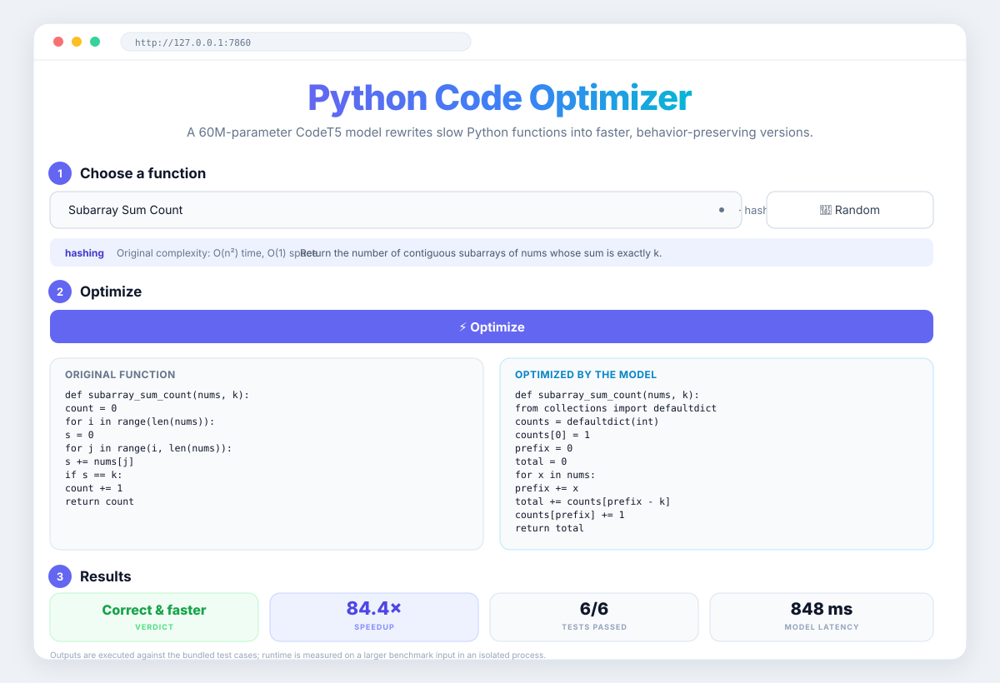

# Python Code Optimizer

A **60M-parameter CodeT5 model** that rewrites a slow Python function into a faster version that keeps the same signature and behaviour. It runs locally on a laptop CPU, in about a second per function, and is small enough to fine-tune on a single GPU.

The project asks a simple question: **can a small seq2seq model beat a large LLM on latency while staying competitive on correctness?** The answer in this repository is yes for this synthetic benchmark: **99.6% of outputs pass their tests, 99.3% are correct and faster, and the median speedup is 84.4×**, with a median inference latency of **848 ms**.



---

## Overview

### What problem does it solve?

Optimising Python by hand is slow and needs expertise. Prompting a large language model works, but every call is expensive and can take seconds. This project fine-tunes a small **CodeT5-small** seq2seq model on **slow → fast function pairs**. The model learns common optimisations directly:

- replace nested loops with hash maps / prefix sums,
- memoise recursive dynamic programming,
- use `str.join`, `Counter`, `set`, and other built-ins,
- replace Python loops with NumPy / BLAS operations,
- avoid building large intermediate lists.

### Who is it for?

- Python developers who want a **local, private, low-latency** optimisation assistant.
- Students and researchers comparing **small specialised models** with general-purpose LLMs.
- Anyone who needs a reproducible **slow-code → fast-code benchmark** with an execution-based correctness harness.

### What the demo does

The Gradio app lets a non-technical user:

1. Pick a slow Python function from a dropdown (or press **Random**).
2. Press **Optimize**. The model generates a faster version.
3. See the **verdict**, **speedup**, **tests passed**, and **model latency**. Both the original and generated code are executed against the bundled test cases, and runtime is measured on a larger benchmark input in an isolated subprocess.

The supplied checkpoint was evaluated on **5,000 held-out test items**. Of those, **4,347 were valid** (the original or reference solution failed its own tests/benchmark on 653 items, mostly the memory category). On the valid set:

| Metric | Result |
|---|---:|
| Test cases passed | **99.6%** (4,328 / 4,347) |
| Correct **and** faster (>1.1×) | **99.3%** |
| Median speedup | **84.4×** |
| Median model latency | **848 ms** |
| Copied input unchanged | **0.0%** |

Numbers are machine-dependent; CPU-only inference is slower than the GPU used for the reported run. Per-item results are in [`eval_results.json`](eval_results.json) and the app's **Overall evaluation results** panel.

---

## Repository contents

```text
.
├── app.py                     # Gradio GUI demo
├── pytorch_train.py           # Fine-tune CodeT5-small (training + validation)
├── evaluate.py                # Execution-based evaluation on the held-out test set
├── main.py                    # Minimal base-model smoke test
├── requirements.txt           # Pinned dependencies
├── eval_results.json          # Per-item results from the 5,000-item evaluation
├── docs/demo.svg              # Demo screenshot/diagram used above
├── dataset/                   # Synthetic dataset generator + dataset validator
│   ├── generate_dataset.py
│   ├── validate_dataset.py
│   ├── examples/              # 200 curated pairs + 40 parameterised families
│   └── reports/validation_report.json
├── data/                      # GENERATED, not committed (about 1.6 GB)
│   ├── all.jsonl
│   ├── train.jsonl
│   ├── val.jsonl
│   ├── test.jsonl
│   └── meta.json
└── checkpoints/               # GENERATED / DOWNLOADED, not committed
    ├── best/                  # Best validation-loss checkpoint (used by app + eval)
    └── final/                 # Final-epoch checkpoint
```

---

## Installation (clean clone)

### 1. Prerequisites

| Requirement | Notes |
|---|---|
| **Python 3.11 or newer** | Tested on **Python 3.14.6** (Windows 11, CPU). Python 3.11–3.14 are supported by the pinned wheels. |
| Disk space | About **2 GB** for the virtual environment and PyTorch, plus **1.6 GB** for the generated dataset, plus **250 MB per checkpoint**. |
| Hardware | **CPU is enough** for the GUI and evaluation. An NVIDIA GPU (CUDA) makes training and generation much faster. Apple Silicon works on CPU; training also supports MPS. |
| Internet | Needed on first use to download the base model `Salesforce/codet5-small` and Python packages. The fine-tuned checkpoint is local. |

### 2. Clone and create an environment

```bash
git clone https://github.com/caleb-sims/CIS377-AI-Project.git
cd CIS377-AI-Project
```

**Windows (PowerShell):**

```powershell
python -m venv .venv
.\.venv\Scripts\Activate.ps1

# If PowerShell blocks activation:
# Set-ExecutionPolicy -Scope Process -ExecutionPolicy Bypass
```

**Windows (Command Prompt):**

```bat
python -m venv .venv
.venv\Scripts\activate.bat
```

**macOS / Linux:**

```bash
python3 -m venv .venv
source .venv/bin/activate
```

### 3. Install the pinned dependencies

```bash
python -m pip install --upgrade pip
python -m pip install -r requirements.txt
```

[`requirements.txt`](requirements.txt) pins every direct library, including the versions used for the reported run:

| Library | Version | Used by |
|---|---:|---|
| `torch` | 2.15.0 | model, training, evaluation |
| `transformers` | 4.57.6 | CodeT5 model/tokenizer |
| `tokenizers` | 0.22.2 | fast tokenizer |
| `safetensors` | 0.8.0 | checkpoint format |
| `huggingface-hub` | 0.36.2 | model download |
| `numpy` | 2.5.4 | vectorisation examples and benchmarks |
| `gradio` | 5.50.0 | GUI demo |

Verify the install:

```bash
python -c "import torch, transformers, gradio; print(torch.__version__, transformers.__version__, gradio.__version__)"
```

Expected output:

```text
2.15.0 4.57.6 5.50.0
```

### 4. Platform-specific notes

- **CPU-only (default on Windows/macOS):** nothing extra to do. Generation works but is slower.
- **NVIDIA GPU (CUDA):** install the matching PyTorch wheel **before** `requirements.txt`, for example:
  ```bash
  pip install torch==2.15.0 --index-url https://download.pytorch.org/whl/cu128
  pip install -r requirements.txt
  ```
  Use the index URL for your CUDA version from <https://pytorch.org/get-started/locally/>. `pip` will keep the already-installed 2.15.0 build.
- **Apple Silicon:** training supports `--device mps`; `app.py` and `evaluate.py` currently fall back to CPU. Use `python pytorch_train.py --device mps ...` if you train locally.
- **Windows evaluation:** the harness uses `resource.setrlimit` on Linux/macOS to cap memory. On Windows that cap is skipped (the module does not exist); the subprocess timeout still applies. For exact resource-limited numbers, run `evaluate.py` on Linux, macOS, or WSL.
- **Do not upgrade `transformers` to 5.x** for this project. `Salesforce/codet5-small`'s tokenizer does not load in current 5.x releases, and Gradio 6.x requires a Hugging Face Hub version that conflicts with `transformers` 4.x.

---

## Data: where it comes from and where to put it

### Source

The dataset is **synthetic and generated from code in this repository**. There is no external dataset download and no MBPP dependency. Each record is a slow Python function (`unoptimized`) paired with a faster, behaviour-equivalent function (`optimized`), plus test cases and a larger benchmark input.

- Generator: [`dataset/generate_dataset.py`](dataset/generate_dataset.py)
- Curated examples and generators: [`dataset/examples/`](dataset/examples)
- Dataset validator: [`dataset/validate_dataset.py`](dataset/validate_dataset.py)
- Dataset documentation: [`dataset/README.md`](dataset/README.md)

The generator combines **200 hand-curated pairs** with **40 parameterised families** and is deterministic for a given seed. The supplied run used:

| Split | File | Examples |
|---|---|---:|
| Training | `data/train.jsonl` | **35,000** |
| Validation | `data/val.jsonl` | **10,000** |
| Test (held out) | `data/test.jsonl` | **5,000** |
| All records | `data/all.jsonl` | 50,000 |

### Generate the exact data (run from the repository root)

```bash
python dataset/generate_dataset.py \
  --num-examples 50000 \
  --val-fraction 0.2 \
  --test-fraction 0.1 \
  --seed 42
```

**Windows Command Prompt / PowerShell (single line):**

```powershell
python dataset/generate_dataset.py --num-examples 50000 --val-fraction 0.2 --test-fraction 0.1 --seed 42
```

Expected output:

```text
wrote 50000 examples to ...\data
  train: 35000  val: 10000  test: 5000
  categories: {"dynamic-programming": 6250, ...}
```

This writes `data/all.jsonl`, `data/train.jsonl`, `data/val.jsonl`, `data/test.jsonl`, and `data/meta.json`. **The `data/` folder is generated and is not committed** because it is about 1.6 GB. The `data/` folder is generated inside the `dataset/` folder. It could become necessary to move the `data/` folder to the root.

### Quick smaller dataset (for a fast pipeline test)

```bash
python dataset/generate_dataset.py --num-examples 500 --val-fraction 0.2 --test-fraction 0.1 --out-dir data_small
```

This creates 350 train / 100 validation / 50 test examples in `data_small/`. Pass the matching paths to training and evaluation:

```bash
python pytorch_train.py --train-file data_small/train.jsonl --val-file data_small/val.jsonl --checkpoint-dir checkpoints_small --num-epochs 1
python evaluate.py --checkpoint checkpoints_small/best --test-file data_small/test.jsonl --limit 20
```

### Validate the generated dataset

```bash
python dataset/validate_dataset.py --in data/all.jsonl --out dataset/reports/validation_report.json --runs 3 --cap 6
```

For every pair this checks all correctness tests, verifies that both versions agree on the benchmark input, and records median runtime and peak memory. The full 50,000-item run takes a while; use a smaller `--in` file for a quick check. The supplied report is in [`dataset/reports/validation_report.json`](dataset/reports/validation_report.json).

### Record format

Each JSONL line contains:

| Field | Meaning |
|---|---|
| `id`, `name`, `category` | Stable ID, unique function name, and one of 8 categories |
| `unoptimized` / `optimized` | Source code strings (seq2seq input / target) |
| `prompt` | Instruction prompt for decoder-only baselines |
| `tests` | `[{"args": [...], "expected": ...}]` correctness cases |
| `benchmark` | `{"args": [...]}` larger input used for timing |
| `technique`, `description`, `complexity_before/after` | Documentation and metadata |

---

## How to train and validate

### Reproduce the submitted training run

From the repository root, after generating `data/`:

```bash
python pytorch_train.py \
  --train-file data/train.jsonl \
  --val-file data/val.jsonl \
  --checkpoint-dir checkpoints \
  --num-epochs 10 \
  --batch-size 8 \
  --gradient-accumulation-steps 1 \
  --learning-rate 1e-4 \
  --weight-decay 0.01 \
  --warmup-ratio 0.05 \
  --max-grad-norm 1.0 \
  --max-source-length 256 \
  --max-target-length 256 \
  --seed 42
```

**Windows (single line):**

```powershell
python pytorch_train.py --train-file data/train.jsonl --val-file data/val.jsonl --checkpoint-dir checkpoints --num-epochs 10 --batch-size 8 --gradient-accumulation-steps 1 --learning-rate 1e-4 --weight-decay 0.01 --warmup-ratio 0.05 --max-grad-norm 1.0 --max-source-length 256 --max-target-length 256 --seed 42
```

This matches the hyperparameters recorded in `checkpoints/best/training_state.json`. Training 35,000 examples for 10 epochs is GPU work: expect **several hours on a T4-class GPU** and much longer on CPU. Add `--device cuda` (or `--device mps`) to force a device; the default is `auto`.

### What happens during training

- Input = `unoptimized`, target = `optimized` (teacher forcing).
- Source and target are truncated/padded to 256 tokens; padding labels are set to `-100`.
- Optimiser: AdamW, linear warmup (5%) then linear decay, gradient clipping at 1.0.
- Mixed precision (FP16) is enabled automatically on CUDA.
- After **each epoch**, the model is evaluated on every example in `data/val.jsonl`.

### Validation and model selection

| Item | Detail |
|---|---|
| Validation file | `data/val.jsonl` (10,000 examples, disjoint from train/test) |
| Metric | **Mean token-level cross-entropy loss** on the validation set (teacher forcing, padding ignored). Perplexity `exp(val_loss)` is printed for readability. |
| Model selection | The epoch with the **lowest validation loss** is saved to `checkpoints/best`. |
| Final checkpoint | The last epoch is always saved to `checkpoints/final`. |
| Early stopping | **None.** All `--num-epochs` epochs run; choose a smaller `--num-epochs` or stop manually if needed. |
| History | `checkpoints/best/training_state.json` stores the epoch, validation loss, arguments, and per-epoch history. |

The app and evaluation use **`checkpoints/best`** by default.

> **Important check:** the training log must show a non-zero validation count, e.g. `val examples: 10000`. If `data/val.jsonl` is missing, `pytorch_train.py` falls back to using the training loss as the "validation" loss. The `training_state.json` supplied with this project records `val_loss == train_loss`, which means that run was started without a readable validation file; its "best" checkpoint is effectively the final epoch. Regenerate the data and rerun the command above to get true validation-based selection.

### Quick training smoke test (CPU, a few minutes)

```bash
python pytorch_train.py --limit 16 --val-limit 8 --num-epochs 1 --batch-size 2 --max-source-length 128 --max-target-length 128 --checkpoint-dir checkpoints_smoke --device cpu
```

This is only a pipeline test; the resulting model will not be useful.

---

## How to run the models

### Base-model smoke test (`main.py`)

```bash
python main.py
```

This loads `Salesforce/codet5-small` (no fine-tuning) to verify that PyTorch, Transformers, the tokenizer, and the model download all work. It prints a short generated string.

### Load the fine-tuned checkpoint directly

```python
from transformers import AutoTokenizer, T5ForConditionalGeneration

checkpoint = "checkpoints/best"
tokenizer = AutoTokenizer.from_pretrained(checkpoint)
model = T5ForConditionalGeneration.from_pretrained(checkpoint).eval()

source = """def subarray_sum_count(nums, k):
    count = 0
    for i in range(len(nums)):
        s = 0
        for j in range(i, len(nums)):
            s += nums[j]
            if s == k:
                count += 1
    return count"""

inputs = tokenizer(source, return_tensors="pt", truncation=True, max_length=512)
output = model.generate(**inputs, max_new_tokens=512, num_beams=4)
print(tokenizer.decode(output[0], skip_special_tokens=True))
```

The model expects **raw function source with no task prefix** (`PREFIX = ""` in `app.py`). Use `num_beams=4` to match the reported results; `num_beams=1` is faster but less accurate.

### Evaluate on the held-out test set (`evaluate.py`)

```bash
python evaluate.py \
  --checkpoint checkpoints/best \
  --test-file data/test.jsonl \
  --train-file data/train.jsonl \
  --beams 4 \
  --out eval_results.json
```

**Windows (single line):**

```powershell
python evaluate.py --checkpoint checkpoints/best --test-file data/test.jsonl --train-file data/train.jsonl --beams 4 --out eval_results.json
```

What this does for every test item:

1. Generates an optimized function from `unoptimized`.
2. Executes the **original**, the **reference optimized** version, and the **model output** in separate subprocesses.
3. Checks every test case and measures median runtime on the larger `benchmark` input (7 runs).
4. Checks for function-name leakage between train and test.

It prints:

```text
valid test items:   4347/5000
tests passed:       99.6%
median speedup:     84.44x
correct AND faster: 99.3%
copied input:       0.0%
median latency:     848 ms
```

and writes per-item results (prediction, pass/fail, speedup, latency) to `eval_results.json`. **This is the held-out test set**; never train on `test.jsonl` or `val.jsonl`.

Useful options:

```bash
python evaluate.py --limit 20                 # quick smoke test
python evaluate.py --checkpoint checkpoints/final
python evaluate.py --beams 1                  # faster, lower quality
```

Evaluation is deliberately conservative: an item only counts as valid if both the original and reference optimized code pass. The 653 excluded items in the reported run are mostly memory-category cases where the reference or baseline benchmark failed; they are excluded from the denominator rather than counted as model failures.

---

## How to run the GUI demo

### Prerequisite: model weights

The fine-tuned checkpoint is **242 MB** and is stored with GIT LFS (GitHub rejects files over 100 MB). The app needs this folder:

```text
checkpoints/
└── best/
    ├── config.json
    ├── generation_config.json
    ├── model.safetensors          # 242 MB
    ├── tokenizer.json
    ├── tokenizer_config.json
    ├── special_tokens_map.json
    ├── vocab.json
    └── merges.txt
```

The demo items are also required. Generate them with the data command above. Then confirm:

```bash
ls checkpoints/best/model.safetensors data/demo.jsonl
```

### Launch

```bash
python app.py
```

Open <http://127.0.0.1:7860> in a browser. The first start loads the model and runs one warm-up generation, so allow 10–30 seconds. On CPU, each **Optimize** click takes roughly 1–3 seconds with 4 beams; a CUDA GPU is faster.

### Use it

1. Choose a function from the dropdown (or click **🎲 Random**). The original code appears on the left, with its category, complexity, and description.
2. Click **⚡ Optimize**. The generated code appears on the right.
3. Read the result cards and table:
   - **Verdict:** Correct & faster / Correct, not faster / Failed tests / Unchanged.
   - **Speedup:** original median runtime ÷ optimized median runtime.
   - **Tests passed:** e.g. `6/6`.
   - **Model latency:** time spent generating the code (not the benchmark runtime).
4. Open **Overall evaluation results** to see the 5,000-item summary embedded in the app.

### Configuration (optional)

`app.py` reads two environment variables:

| Variable | Default | Meaning |
|---|---|---|
| `MODEL_DIR` | `./checkpoints/best` | Folder containing the fine-tuned model + tokenizer |
| `TEST_PATH` | `./data/demo.jsonl` | Held-out test items used by the dropdown |

**Windows PowerShell:**

```powershell
$env:MODEL_DIR = "checkpoints/final"
$env:TEST_PATH = "data/demo.jsonl"
python app.py
```

**macOS / Linux:**

```bash
MODEL_DIR=checkpoints/final TEST_PATH=data/demo.jsonl python app.py
```

To use a different port, set Gradio's standard variable:

```powershell
$env:GRADIO_SERVER_PORT = "7861"
python app.py
```

or:

```bash
GRADIO_SERVER_PORT=7861 python app.py
```

### Troubleshooting the demo

| Symptom | Fix |
|---|---|
| `Model folder not found: ...` | Put the checkpoint at `./checkpoints/best`, or set `MODEL_DIR` to the folder containing `config.json` and `model.safetensors`. |
| `Test file not found: ...` | Generate `data/test.jsonl`, or set `TEST_PATH` to its location. |
| Port 7860 already in use | Set `GRADIO_SERVER_PORT=7861` (or another free port). |
| Slow on CPU | Lower `NUM_BEAMS` in `app.py` from `4` to `1`, or use a CUDA GPU. |
| Out of memory | Close other apps; the model uses about 500 MB of RAM. Generation with 4 beams on 512-token outputs is the main cost. |
| First run hangs | It is downloading `Salesforce/codet5-small` (about 250 MB) because the tokenizer files are missing from the checkpoint; check your internet connection. |

**Safety note:** the demo executes model-generated Python code in a subprocess with a timeout. It is designed for the bundled test functions, **not** for arbitrary untrusted code. Do not expose the app to the public internet or feed it untrusted functions.

---

## Reproduce the report from a clean clone

Run these steps in order:

```bash
# 1. Install (see Installation for Windows activation commands)
python -m venv .venv
source .venv/bin/activate              # Windows: .\.venv\Scripts\Activate.ps1
python -m pip install --upgrade pip
python -m pip install -r requirements.txt

# 2. Generate the exact 50k dataset
python dataset/generate_dataset.py --num-examples 50000 --val-fraction 0.2 --test-fraction 0.1 --seed 42

# 3. Get checkpoints/best (download the submitted folder, or train it)
python pytorch_train.py --train-file data/train.jsonl --val-file data/val.jsonl --checkpoint-dir checkpoints --num-epochs 10 --batch-size 8 --learning-rate 1e-4 --max-source-length 256 --max-target-length 256 --seed 42

# 4. Evaluate on the held-out test set
python evaluate.py --checkpoint checkpoints/best --test-file data/test.jsonl --train-file data/train.jsonl --beams 4 --out eval_results.json

# 5. Launch the demo
python app.py
```

If you only want to verify the GUI quickly, generate the smaller dataset and train the smoke-test checkpoint:

```bash
python dataset/generate_dataset.py --num-examples 500 --val-fraction 0.2 --test-fraction 0.1 --out-dir data_small
python pytorch_train.py --train-file data_small/train.jsonl --val-file data_small/val.jsonl --checkpoint-dir checkpoints_small --num-epochs 1 --batch-size 2
$env:MODEL_DIR = "checkpoints_small/best"; $env:TEST_PATH = "data_small/test.jsonl"   # PowerShell
python app.py
```

The small model is only for checking that the UI and pipeline work; it will not reproduce the reported quality.

---

## Model details

| Item | Value |
|---|---|
| Base model | [`Salesforce/codet5-small`](https://huggingface.co/Salesforce/codet5-small) |
| Architecture | T5 seq2seq (encoder–decoder), 6 + 6 layers, `d_model=512`, 8 heads |
| Parameters | 60,492,288 |
| Input | Python function source (`unoptimized`), no task prefix |
| Output | Optimised function source (`optimized`) |
| Max source/target length | 256 tokens for training/evaluation; 512 in the GUI |
| Decoding | Beam search, 4 beams |
| Training data | 35,000 synthetic slow → fast pairs |
| Validation data | 10,000 disjoint pairs, selected by validation loss |
| Test data | 5,000 disjoint pairs, never used for training or selection |
| Training hardware | The supplied checkpoint was trained on a Colab GPU with data in Google Drive |

The three large decoder-only models in the original project plan (Qwen, Gemma, SmolLM) are **comparison baselines** and are not required to run this repository. The shipped pipeline, checkpoints, evaluation, and GUI are for the CodeT5 seq2seq model.

---

## FAQ / common issues

**`pip` reports a conflict between `transformers` and `gradio`.**  
Use the pinned versions in `requirements.txt`. `gradio==5.50.0` is chosen because it works with `huggingface-hub < 1.0`, which `transformers==4.57.6` requires.

**`TypeError: Input must be a List[Union[str, AddedToken]]` when loading CodeT5.**  
You are on `transformers` 5.x. Reinstall the pinned version: `python -m pip install transformers==4.57.6 tokenizers==0.22.2 huggingface-hub==0.36.2`.

**`UnicodeDecodeError` on Windows.**  
The current `evaluate.py` opens all data files with UTF-8. If you are on an older copy, add `encoding="utf-8"` to the `open(...)` calls.

**Training is too slow / runs out of memory.**
Reduce `--batch-size` (e.g. 4 or 2), keep `--max-source-length`/`--max-target-length` at 128–256, or use `--gradient-accumulation-steps` to keep an effective batch size of 8. On Apple Silicon add `--device mps`; on NVIDIA use `--device cuda`.

**Evaluation takes too long.**
Use `--limit 20` for a smoke test. The full run executes Python code in subprocesses for 5,000 items and is expected to take a while.

**Can I use the GUI for arbitrary functions?**
Not safely. The bundled demo only offers functions from `data/demo.jsonl`, because it executes generated code. Adding a free-text input would require a hardened sandbox.
